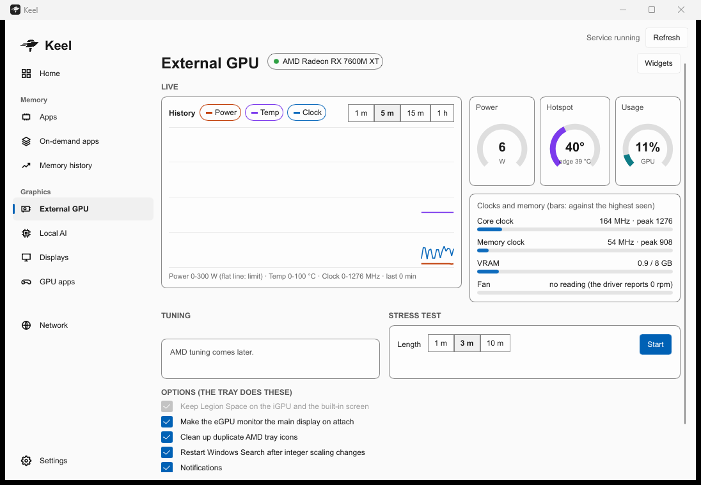
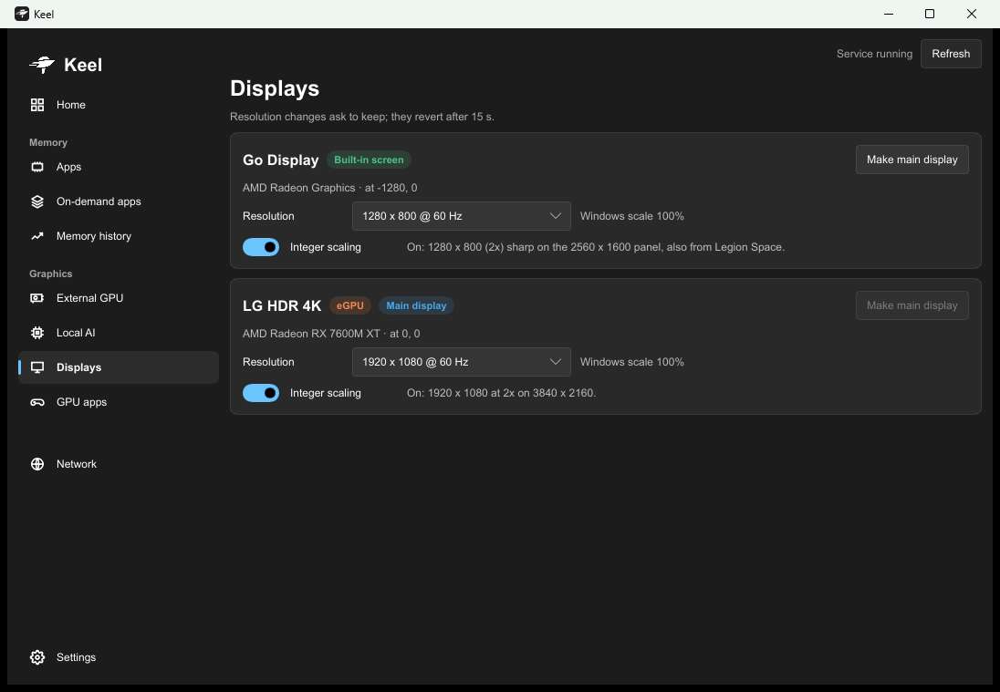
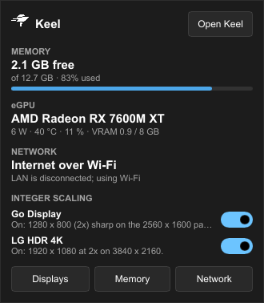

<p align="center">
  <picture>
    <source media="(prefers-color-scheme: dark)" srcset="assets/keel-256-light.png">
    
  </picture>
</p>

<h1 align="center">Keel</h1>

A Windows companion for **eGPU users on handheld PCs**, built on and for the Lenovo Legion Go
(Ryzen Z1 Extreme). Keel keeps an NVIDIA or AMD external GPU, the built-in screen, Legion Space
and a small amount of RAM working together: one background service, a tray icon and a main window.

<p>
  
  
</p>
<p>
  
</p>

## What it does

- **NVIDIA and AMD eGPUs, without DDU.** An AMD eGPU gets its own driver, installed on that
  device only (matched by its exact hardware ID), so the handheld's iGPU keeps the vendor driver.
  Windows Update is kept from replacing the eGPU driver. No Display Driver Uninstaller, no
  reinstalling the iGPU driver after every eGPU driver update.
- **Switch between eGPUs.** Any eGPU Windows reports as removable (USB4, Thunderbolt, OCuLink dock)
  gets its own profile on first attach, starting at the driver defaults; limits and scaling records
  are kept per GPU. Plug an NVIDIA
  card in after an AMD one, or back, and Keel picks up the right one. NVIDIA's helper services can
  be stopped while no NVIDIA GPU is present (opt-in) and come back when one is.
- **Legion Space and the eGPU get along.** Legion Space stays on the iGPU, and a resolution picked
  in Legion Space goes to the built-in screen instead of the eGPU monitor. Its windows are kept on
  the built-in screen when that is the main display (see [Scenarios](#scenarios)).
- **Resolution and integer scaling on every screen.** For eGPU monitors (NVIDIA and AMD) and the
  built-in screen (through the iGPU driver): pick an exact divisor such as 1920 x 1080 on a 4K
  monitor or 1280 x 800 on the 2560 x 1600 panel and every pixel stays sharp. While a game runs,
  integer scaling follows the game's own mode and comes back when it exits. Mode changes ask to
  keep them and revert after 15 seconds.
- **Local AI that behaves on an eGPU.** Shows how much eGPU memory is free, which installed
  Ollama models fit in it and which would spill into system RAM, and what is loaded now (GPU vs
  RAM split, unload, end Ollama). Models are unloaded when a game starts and when the eGPU is
  unplugged. AI mode switches apps you pick off while a model is loaded.
- **On-demand apps.** Apps leave helpers behind: services, scheduled tasks, startup entries,
  updaters. Keel groups them by vendor and install folder into *families* and keeps a family off
  until you use it: "Keep off", or "Follow app" (on while the app runs, off again after it exits).
  Everything is recorded before it is switched and put back when you choose "Back to normal" or
  uninstall Keel.
- **Simple eGPU tuning.** Live power, temperature, clocks, usage and VRAM; power limit and clock
  ceilings on NVIDIA, NVIDIA 3D settings, Radeon features (and power / clock tuning where the AMD
  driver offers it); a short stress test to find the card's real peaks. Only what the card and
  driver support is shown.
- **Adrenalin recovery.** When AMD Adrenalin hangs without a window after a launch, Keel restarts
  it (automatically or from the tray).
- **GPU apps.** Installed games from Steam, Epic and GOG, each with a switch to run on the eGPU
  (Windows' per-app GPU choice), plus your own game folders and programs.
- **Also:** memory history with leak detection, a tray panel, app icon colours, light and dark
  themes, and optional network routing (internet over Wi-Fi or LAN, a side and kill switch per
  VPN, Wi-Fi kept on beside the LAN; any wired adapter, any Windows language). Network routing
  is off until you set it up.

## Scenarios

| Setup | What happens |
|---|---|
| eGPU monitor is the **main display** | Apps start on the eGPU. Legion Space always opens its windows on the main display and puts them back if moved, so Keel **cannot pin Legion Space to the built-in screen** here; that option is greyed out. Legion Space still runs on the iGPU, and a resolution chosen in it is applied to the built-in screen. |
| Built-in screen is the **main display**, eGPU monitor extended | Legion Space windows are kept on the built-in screen. Apps you set to the eGPU (GPU apps) still render there. |
| Built-in screen **off** | Nothing to pin; Legion Space follows the main display. |
| **No eGPU** | eGPU pages show "not attached", Local AI is off (models would only take system RAM), integer scaling on the built-in screen keeps working. |
| **Game running** | Integer scaling follows the game's mode (sharp for exact divisors, stretched otherwise) and returns afterwards; Ollama models are unloaded first. |
| **eGPU unplugged** | Ollama models are unloaded; the other eGPU settings wait for the next attach. |
| **Switching NVIDIA <-> AMD** | The new card's profile applies; the AMD driver stays bound to the AMD card only. |

## Install

1. Download `keel-setup-<version>.exe` and its `.sha256` file from
   [Releases](../../releases).
2. Check the download before running it. In PowerShell:

   ```powershell
   Get-FileHash .\keel-setup-<version>.exe -Algorithm SHA256
   ```

   The hash must match the one in the `.sha256` file and in the release notes. If it does not,
   do not run the file.
3. Run the installer as administrator. It installs to `C:\Program Files\Keel`, registers the
   `Keel` service, starts the tray at logon and (optionally) adds `keel` to the PATH. Upgrades
   install over the old version and keep your settings.

```powershell
keel status        # service and features
keel help          # command-line tools (memory, eGPU, displays, network)
```

To build it yourself instead (Windows 11, Rust stable with MSVC, Inno Setup 6):
`.\build.ps1` builds, runs the tests and writes `dist\keel-setup-<version>.exe` with its SHA-256.

### Windows warnings, and what Keel can do on your PC

The installer is **not code-signed** (a signing certificate costs money every year for a hobby
project). Expect this:

- **SmartScreen** shows "Windows protected your PC" for an unknown publisher. "More info" then
  "Run anyway" starts it. Do this only after the hash matched.
- **Microsoft Defender or other antivirus** may flag or quarantine it, mostly because a new,
  unsigned program installs a service and changes system settings. If yours does, check the hash,
  and if you are unsure, don't install it; you can read the source and build it yourself.

Keel runs a service as LocalSystem, so it can change the system. Here is all of it:

| Part | What it may change | When |
|---|---|---|
| eGPU | power limit and clock ceilings (NVIDIA), Radeon features, NVIDIA 3D settings, display modes and scaling, the AMD eGPU's driver binding, a Windows Update block for that driver | only what you set; profiles start at the driver defaults |
| eGPU | stops / starts NVIDIA's helper services | only if you turn that option on |
| On-demand apps / AI mode | service start types, scheduled tasks, startup entries of app families you pick; ends their processes | only families you pick; never Windows core, GPU drivers, the handheld vendor's or security software |
| Network | interface metrics, routes, firewall rules for VPN kill switches | only after you turn Network on and set it up |

- Every change is recorded first (registry exports, original values) and is put back by
  "Back to normal", by turning the feature off, or by uninstalling Keel.
- Drivers are never deleted. No kernel drivers, and no code is injected into other programs.
  The service only does fixed jobs on request; it never runs a path or command it is sent.
- Keel sends nothing over the internet: no telemetry, no update checks. The only network
  connection it makes is to Ollama on your own PC (`127.0.0.1:11434`) for Local AI.
- Uninstalling stops the service and puts back everything it changed.

**Use at your own risk.** Keel is tested on one Legion Go (Ryzen Z1 Extreme) with an NVIDIA
RTX 2080 Ti and an AMD RX 7600M XT on a USB4 dock. Other eGPUs and handhelds should work but are
untested. Keel is not affiliated with Lenovo, AMD, NVIDIA or Microsoft.

## Layout

```
apps/keel      keel.exe: command line and the service entry
apps/tray      keel-tray.exe: tray icon, menu, display hand-over, memory sampling
apps/gui       keel-gui.exe: main window and tray panel (Slint)
crates/core    shared: paths, logs, settings, control pipe, app icon
crates/ram     memory: scan, families, on-demand apps, memory history
crates/egpu    eGPU: drivers, limits, telemetry, displays, integer scaling, games, Legion Space
crates/net     network routing
crates/service the Keel service
installer      Inno Setup script
```

See [CHANGELOG.md](CHANGELOG.md) for releases.

## License

[MIT](LICENSE). Free to use, change and share; it comes with no warranty.

The user interface is made with [Slint](https://slint.dev), used under the Slint Royalty-free
Desktop, Mobile, and Web Applications License 2.0.

[](https://slint.dev)
